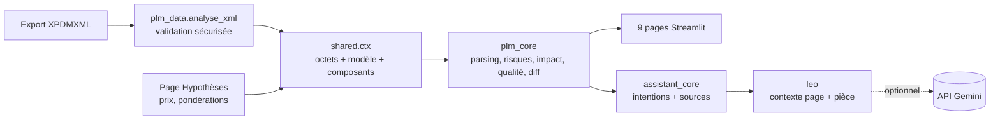

# PLM Intelligence : Dassault Systèmes × ESILV

PLM Intelligence Challenge : transformer un export XPDMXML de 3DEXPERIENCE en informations traçables pour un
fournisseur de moteurs électriques. L'appli sert à comprendre le produit, repérer les risques et évaluer l'impact
d'un changement.

## Lancer l'appli

```bash
pip install -r requirements.txt
python -m streamlit run app.py
```

L'export de référence `data/XPDMXML_ECAR_PLM.xml` est chargé par défaut. Pour analyser un autre export,
utiliser **Source des données** dans la barre latérale. Toutes les pages sont alors recalculées.

## Pages

| Section | Page | Origine | Contenu |
|---|---|---|---|
| Comprendre | Vue d'ensemble | Page1 + `plm_data` | Chiffres clés, sous-ensembles, sunburst des masses, points de vigilance, parcours |
| | Explorateur BOM | Page2 | Arbre et tableau BOM, filtres, sunburst/treemap, fiche rapide, export CSV |
| | Fiche composant | Page3 | Identité, propriétés, révisions, comparaison de deux pièces, position et contrôle de masse |
| Identifier | Risques | Page4 + `plm_core` | Priorité structurelle 100 % XML, risque enrichi*, dépendance fournisseurs*, choc de prix matières* |
| | Qualité des données | `plm_core` + `plm_data` | Constats classés par gravité, cohérence des masses, complétude, en-tête de l'export |
| Évaluer | Analyse d'impact | `impact_page` | Changement de version, fournisseur ou coût, propagation animée, conflits de maturité, rapport HTML/PDF |
| | Comparer deux exports | `plm_core.diff_models` | Écarts V1/V2 (révision, maturité, masse, matériau, quantités), V2 simulé pour la démo |
| Outils | Léo | `leo` + `assistant_core` | Assistant contextuel (page + pièce active), Gemini gratuit ou mode calcul, sources citées |
| | Hypothèses | `plm_core` | Prix matières (sources 2026), pondérations du risque, fournisseurs simulés, tout est modifiable |

\* Les valeurs marquées d'un astérisque sont des **hypothèses** : l'export de l'OEM ne contient ni coût ni fournisseur.

## Architecture



- `app.py` : navigation, barre latérale commune, **pièce active partagée** (`st.session_state["sel_xml"]`).
  Choisir une pièce dans une page la sélectionne partout.
- `shared.py` : chargement unique des données (cache), navigation entre pages, thème, étiquettes source/hypothèse.
- `plm_core.py` : moteur métier sans Streamlit (réutilisable par une API FastAPI ou un frontend React).
- `plm_data.py` : validation de l'import (taille, encodage, DTD/entités refusées, racine unique, liens, cycles).
- `viz3d.py` : graphes 3D (structure produit en orbite, nuage de risques, surface de sensibilité).
- `leo.py` : assistant Léo (bulle flottante, dialogue, clé API locale).
- `views/` : une page par fichier.

## Léo, l'assistant PLM

Léo est présent sur toutes les pages (bulle en bas à droite) et dispose d'une page dédiée. Il connaît la page
ouverte et la **pièce active** : cliquer sur une pièce n'importe où dans l'appli change ce qu'il explique.
Boutons rapides : « Résumer cette page », « Expliquer <pièce> », « Que faire ensuite ? ».

Moteur : **API Gemini de Google**, offre gratuite (Gemini 3.8 Flash par défaut, repli automatique sur 3.7, 3.6, 3.5 Flash si saturé). Créer une clé sur <https://aistudio.google.com/apikey>, puis au choix :

- la coller dans *Réglages de Léo* : elle est enregistrée dans `.secrets/gemini_api_key`, **ignoré par git** ;
- ou `GEMINI_API_KEY` en variable d'environnement, ou dans `.streamlit/secrets.toml` (également ignoré).

Sans clé, Léo répond quand même : `assistant_core` reconnaît l'intention (structure, risques, impact, versions,
fournisseurs, coûts, masses, matériaux, qualité, cas d'emploi), calcule la réponse et cite les objets XML utilisés.
Avec une clé, Gemini rédige la réponse à partir de ce calcul et du contexte de la page, sans autre source.

## Limites connues

- Chaque page de l'équipe garde son propre parseur (Page2, Page3, Page4), mais toutes lisent les mêmes octets.
  Une étape suivante serait de les faire toutes passer par `plm_core`.
- Fournisseurs et facteurs de transformation : fictifs. Prix matières : ordres de grandeur publics de fin 2026.
- L'export ne contient que la révision courante : l'historique ne peut venir que de la comparaison d'exports.
- Le rendu `assets/edrive_render.png` provient de la présentation du sujet.
